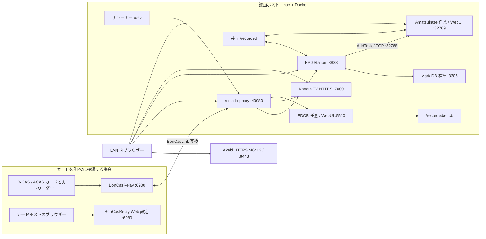

# docker-recisdb-epgstation-konomitv

## 概要

Ubuntu のパソコンでテレビ番組を録画し、番組表から予約できます。
同じ LAN のパソコンやスマートフォンから番組表を開き、録画番組や放送中のテレビを視聴できます。
チューナーの管理と番組情報の連携は recisdb-proxy、予約と録画管理は EPGStation、テレビ視聴は KonomiTV が担当します。
カードリーダーを録画用 PC に接続する構成では、BonCasRelay も同じ PC で動かします。



## 用意するもの

- [ ] Ubuntu を入れられる 64 bit パソコン 1 台。録画用 PC は常時起動でき、録画先に十分な空き容量があるものを用意してください。
- [ ] Linux 用ドライバーに対応したテレビチューナー。例: PLEX PX-W3U4 / PX-Q3U4 / PX-MLT 系、DTV02A など。型番・ドライバー版で対応状況が異なるため、[対応機器とドライバー](https://github.com/stuayu/recisdb-proxy-rs#linux-へのインストール-コピペで完了)を確認してください。
- [ ] B-CAS または ACAS カードと、対応する USB カードリーダー。
- [ ] チューナーにつなぐアンテナ線。地上波・BS/CS の視聴には対応するアンテナ設備も必要です。
- [ ] インストール時に使う USB メモリー (Ubuntu インストール用)。
- [ ] インターネット接続と、録画ホスト・視聴端末をつなぐ同じ LAN。

**おすすめ:** 録画用 PC 1 台にチューナーとカードリーダーを両方 USB 接続します。セットアップで BonCasRelay の「このマシンで動かす (local)」を選びます。別 PC のカードリーダーを使う手順は「[カードリーダーを別の PC につなぐ場合](#カードリーダーを別の-pc-につなぐ場合)」にあります。

## 導入手順

### 1. Ubuntu 24.04 LTS をインストールする

[Ubuntu 24.04 LTS 公式ダウンロード](https://ubuntu.com/download/desktop)から Ubuntu を入手してください。インストール USB の作成とインストールは[公式チュートリアル](https://ubuntu.com/tutorials/install-ubuntu-desktop)に沿って進めます。既存データを消去する選択肢が表示された場合は、対象ディスクを確認してから進んでください。

### 2. ターミナルを開く

Ubuntu のデスクトップで `Ctrl` + `Alt` + `T` を押すと、コマンドを入力する黒い画面 (ターミナル) が開きます。この README のコマンドは、行ごとコピーしてターミナルへ貼り付けます。貼り付けは `Ctrl` + `Shift` + `V` です。

`sudo` で始まるコマンドは管理者権限を使うため、Ubuntu のログインパスワードを尋ねます。入力中は画面に文字も記号も表示されません。入力して Enter を押してください。

### 3. 機器をつなぐ

チューナーとカードリーダーを録画用 PC の USB 端子につなぎ、アンテナ線をチューナーにつなぎます。カードリーダーに B-CAS / ACAS カードを挿してください。

### 4. git を入れて、このリポジトリを取得する

次を順に実行します。

```bash
sudo apt update
sudo apt install -y git
git clone https://github.com/stuayu/docker-recisdb-epgstation-konomitv.git
cd docker-recisdb-epgstation-konomitv
```

### 5. セットアップを実行する

```bash
./setup.sh
```

セットアップはホストを確認し、不足ソフトの導入を提案します。提案順は Docker / Docker Compose、対応チューナーが検出された場合の px4_drv、NVIDIA GPU が検出された場合の NVIDIA Container Toolkit です。導入前に実行内容を表示して確認を求めます。px4_drv は対応 USB チューナーを検出し、ドライバーやデバイスノードがない場合に提案します。NVIDIA のグラフィックスドライバー本体は別途必要です。導入の根拠と手動手順は[技術者向け設定・運用](docs/ADVANCED.md)にあります。

画面が開いた場合は、矢印キーで項目を移動し、スペースでチェックを切り替え、Enter で決定します。Tab で画面下部のボタンへ移動できます。画面を使わない場合はターミナルの質問に答えてください。

迷ったときは次を選んでください。

- 使うソフト: EPGStation の録画・視聴には EDCB と Amatsukaze は不要です。使う予定がなければチェックを外します。初期状態では EDCB / Amatsukaze / HTTPS が選択されています。
- チューナー: 検出されたものをすべて選択します (既定)。
- 録画先: 初期値 `./data/recorded` または空き容量のある保存先を選びます。録画を長く保存する場合は大容量ディスクを指定してください。
- カードサーバー: カードリーダーをこの PC に接続したなら `local`。
- GPU: 自動検出された初期値を使います。GPU がない場合は `none`。
- ポート: ほかのアプリと重ならなければ初期値のままにします。

不足ソフトの導入を選んだときは、表示されたコマンドと確認画面を読み、実行を承認します。NVIDIA Container Toolkit の設定では Docker を再起動するため、実行中のほかの Docker アプリも一時停止します。Docker の利用権限を直すためユーザーを docker グループへ追加した場合、いったん Ubuntu からログアウトして再ログインし、ターミナルでリポジトリのフォルダーへ戻って `./setup.sh` をもう一度実行します。初回ビルドは環境によって数十分かかります。進捗中はターミナルを閉じずに待ちます。

### 6. ブラウザーで番組表とテレビを開く

セットアップ後、録画ホストで `Ctrl` + `Alt` + `T` を押してターミナルを開き、次を実行します。

```bash
hostname -I
```

表示されたアドレスのうち、家庭内 LAN の IPv4 アドレスを使います。たとえば `192.168.1.30` の場合、EPGStation は `http://192.168.1.30:8888/`、KonomiTV は `https://192-168-1-30.local.konomi.tv:7000/` です。KonomiTV の URL では IP アドレスの `.` を `-` に置き換えます。

同じ LAN に接続したスマートフォンや別の PC のブラウザーでも開けます。EPGStation の番組表で番組を選んで録画予約し、KonomiTV で放送中のテレビを視聴します。電波状況によって番組表やチャンネルが表示されるまで時間がかかることがあります。

## うまくいかないとき

| 症状 | まず試すこと |
| --- | --- |
| `./setup.sh` が Docker を使えないと言う | Docker の導入が終わっているか確認します。ユーザーを docker グループへ追加した直後ならログアウト・再ログインしてから再実行します。 |
| チャンネルが映らない / 番組表が空 | チューナーとアンテナ線を確認し、ターミナルで `make scan` を実行します。電波を受ける設備を確認してください。 |
| カードを認識しない / 暗号化番組が映らない | カードの向きとカードリーダーの USB 接続を確認し、セットアップで `local` を選んだか確認します。別 PC の場合は[カードホスト手順](docs/BONCASRELAY.md)を確認します。 |
| スマートフォンからページを開けない | スマートフォンが録画 PC と同じ Wi-Fi / LAN か確認し、録画 PC の IP アドレスを `hostname -I` で調べ直します。 |
| KonomiTV のページで接続エラー | `https://` で始まり、IP の `.` が `-` に変わった URL か確認します。DNS Rebinding 保護が名前解決を止める場合は[アクセス方法](docs/ADVANCED.md#アクセス方法)を確認します。 |
| セットアップやビルドでエラー | ターミナルに表示されたエラーを保存し、空き容量を確認します。詳細は[トラブルシュート](docs/ADVANCED.md#よくある質問トラブルシュート)を参照してください。 |

## 日々の使い方

ターミナルを開き、リポジトリのフォルダーでコマンドを実行します。

| 操作 | コマンド |
| --- | --- |
| 状態確認 | `make status` |
| 起動 | `make up` |
| 停止 | `make down` |
| ログ確認 | `make logs` |
| 更新・再ビルド | `make update` |
| バックアップ | `make backup` |

バックアップには設定とデータベースの SQL dump が含まれます。録画ファイルは含まれないため、別途コピーしてください。復元方法や予約・録画の注意点は[バックアップと復元](docs/ADVANCED.md#バックアップと復元)を参照してください。

## カードリーダーを別の PC につなぐ場合

カードリーダー側の PC を「カードホスト」と呼びます。Linux / macOS / Windows に BonCasRelay を導入し、録画ホストからの接続だけを許可します。カードホストでは BonCasRelay の TCP 6900 を録画ホストから許可し、Web 設定ポート 6980 は公開しません。BonCasLink 互換通信は平文・無認証です。ポートをインターネットへ公開せず、信頼できる LAN 内に限定してください。

OS ごとの PC/SC 確認、BonCasRelay のビルドと常駐化、ファイアウォール設定は[BonCasRelay とカードリーダー](docs/BONCASRELAY.md)を参照してください。

---

ここから先は技術者向けの情報です。普通に使うだけなら読む必要はありません。

## 技術者向け目次

- [システム構成](#システム構成)
- [アクセス経路](#アクセス経路)
- [構成ファイル一覧](#構成ファイル一覧)
- [設定ファイルの編集と再生成](#設定ファイルの編集と再生成)
- [GPU / エンコード自動設定](#gpu--エンコード自動設定)
- [ファイアウォール](#ファイアウォール)
- [手動セットアップ](#手動セットアップ)
- [任意機能](#任意機能)
- [詳細ドキュメント](#詳細ドキュメント)

## システム構成

| サービス | 用途 | 主なポート |
| --- | --- | --- |
| recisdb-proxy | チューナー管理、Mirakurun 互換 API | HTTP 40080 |
| EPGStation | 番組表、予約、録画管理 | HTTP 8888 |
| KonomiTV | テレビ・録画視聴 (Akebi 経由) | HTTPS 7000 |
| MariaDB | EPGStation データベース | Compose 内 TCP 3306 |
| Akebi gateway | recisdb-proxy / EPGStation の HTTPS | HTTPS 40443 / 8443 |
| EDCB (任意) | 録画・Material WebUI | HTTP 5510、HTTPS 8553 |
| Amatsukaze (任意) | CM カット・エンコード | WebUI 32769、内部 TCP 32768 |

詳細なサービス、ポート、構成ファイルは[技術者向け設定・運用](docs/ADVANCED.md)にあります。

## アクセス経路

HTTP は recisdb-proxy `40080`、EPGStation `8888`、EDCB 有効時の WebUI `5510`、Amatsukaze `32769` で利用します。KonomiTV は HTTPS `7000` を使います。Akebi gateway を有効にすると recisdb-proxy は `40443`、EPGStation は `8443`、EDCB は `8553` でも接続できます。MariaDB は Compose 内だけで公開します。

HTTPS 名、DNS Rebinding、Akebi の転送先などは[アクセス方法の詳細](docs/ADVANCED.md#アクセス方法)を参照してください。

## 構成ファイル一覧

Compose ファイルはサービスの組合せ、`config/` は編集可能な設定、`data/` はデータベースやログなどの永続データ、`.env` はポートや保存先を管理します。`compose.tuners.yaml` と `compose.storage.yaml` はセットアップが生成します。

全ファイルと保存先の一覧は[構成ファイル](docs/ADVANCED.md#構成ファイル)にあります。

## 設定ファイルの編集と再生成

設定は `config/<サービス>/` に保存します。`.env` の値を変更した後、必要な設定を差分確認付きで作り直すには次を使います。

```bash
make regen-config SERVICE=epgstation
```

詳細は[設定ファイルの編集](docs/ADVANCED.md#設定ファイルの編集)を参照してください。

## GPU / エンコード自動設定

セットアップは GPU を検出し、Intel / AMD / NVIDIA 用 Compose 設定を選びます。GPU ドライバーやエンコード方式の対応範囲は[GPU 設定ガイド](docs/GPU.md)を参照してください。録画ホストの手動準備は[技術者向け設定・運用](docs/ADVANCED.md#gpu-任意)にあります。

## ファイアウォール

Web 画面や Mirakurun API をインターネットへ直接公開しないでください。BonCasLink 通信は平文・無認証です。Docker の公開ポートは UFW の通常ルールを迂回する場合があるため、LAN 制限はルーター ACL または Docker `DOCKER-USER` chain で設定します。手順は[録画ホストのファイアウォール](docs/ADVANCED.md#録画ホストのファイアウォール)にあります。

## 手動セットアップ

経験者向けのセットアップ、Compose の生成と検証、サービス起動手順は[手動セットアップ](docs/ADVANCED.md#手動セットアップ-経験者向け)を参照してください。

## 任意機能

- **EDCB:** Material WebUI、EDCB の録画を EPGStation へ自動登録、backfill、設定移行は[EDCB ガイド](docs/EDCB.md)を参照してください。
- **Amatsukaze:** EPGStation 連携、録画の共有、GPU エンコード、トラブル対応は[Amatsukaze ガイド](docs/AMATSUKAZE.md)を参照してください。
- **BonCasRelay:** 同じ PC での同梱起動と USB 再接続動作は[BonCasRelay ガイド](docs/BONCASRELAY.md#boncasrelay-を同じマシンで動かす)を参照してください。
- **EPGStation DB:** MariaDB の構成とバックアップ上の注意は[技術者向け設定・運用](docs/ADVANCED.md#epgstation-の-db-mariadb-固定)を参照してください。

## 詳細ドキュメント

- [技術者向け設定・運用](docs/ADVANCED.md)
- [EDCB と EPGStation 連携](docs/EDCB.md)
- [Amatsukaze](docs/AMATSUKAZE.md)
- [BonCasRelay とカードリーダー](docs/BONCASRELAY.md)
- [GPU 設定ガイド](docs/GPU.md)
- [チューナー自動設定の調査・設計](docs/TUNER_SETUP.md)
- [提案資料](docs/PROPOSAL.md)
- [開発・検証記録](docs/DEVELOPMENT.md)
