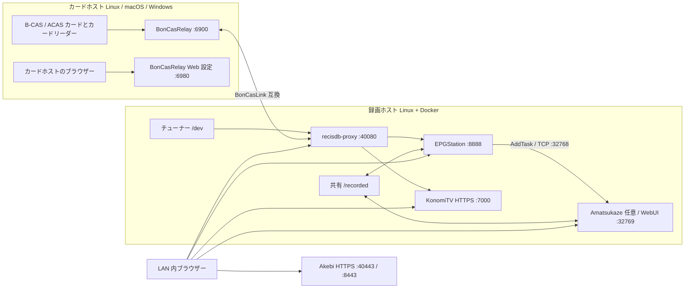

# docker-recisdb-epgstation-konomitv

この構成は Linux 上の Docker Compose でテレビ放送を録画・視聴するシステムです。
recisdb-proxy がチューナーを管理し、Mirakurun 互換 API で EPGStation と KonomiTV に番組情報を渡します。
B-CAS / ACAS カードは BonCasRelay から LAN 経由で利用します。



## 必要なもの

- Linux 録画ホスト。Ubuntu 24.04 LTS または Debian 12 を推奨します。
- Docker Engine と Compose v2。初回ビルドに数 GB の空きディスク容量が必要です。メモリは 8 GB 以上を推奨します。
- recisdb-proxy-rs が対応するチューナーと Linux ドライバー。例: PLEX PX-W3U4 / PX-Q3U4 / PX-MLT 系、DTV02A など。型番・ドライバー版で対応状況が異なります。`/dev/px4video*`、`/dev/pt3video*`、`/dev/pxmlt5video*`、`/dev/isdb2056video*` または `/dev/dvb/adapterN` のノードを使います。`isdb6014video*` は参照 README に対応記載がありません。
- B-CAS または ACAS カードとカードリーダー。カードホストと録画ホストは同じ LAN に置いてください。カードホストは録画ホストと同じマシンでも構いません。
- KonomiTV の Dockerfile を含むソース。セットアップが `stuayu/KonomiTV` を取得できます。

## ホスト機側の準備

### カードホスト (BonCasRelay とカードリーダー)

カードホストは Linux / macOS / Windows のいずれでも構いません。PC/SC は、アプリがカードリーダーを利用するための OS 共通 API です。カードリーダーの USB 接続後、OS 側で認識することを確認してください。

#### Linux (Ubuntu / Debian): PC/SC

```bash
sudo apt update
sudo apt install -y pcscd libpcsclite1 libccid pcsc-tools
sudo systemctl enable --now pcscd
pcsc_scan
```

`pcsc_scan` にリーダー名とカード挿入状態が出ることを確認します。終了は `Ctrl+C`。パッケージと `pcscd` の手順は recisdb-proxy-rs README の PC/SC 節に基づいています。

#### macOS: PC/SC

macOS 標準の PC/SC (CryptoTokenKit) を使います。追加の `pcscd` は導入しません。BonCasRelay をビルドした後、次でリーダーを列挙します。

```bash
boncasrelay --list-readers
```

出力にカードリーダー名があることを確認します。カードを挿しても出ない場合は、カードリーダーの USB 接続と macOS のシステム情報を確認してください。

#### Windows: Smart Card サービス

PowerShell で Smart Card サービス (`SCardSvr`) を確認します。

```powershell
Get-Service SCardSvr
```

停止中なら管理者 PowerShell で起動します。

```powershell
Start-Service SCardSvr
```

BonCasRelay をビルド後、`boncasrelay.exe --list-readers` でリーダー名を確認します。

#### BonCasRelay をソースからビルド

BonCasRelay の GitHub Releases にビルド済み配布ファイルはまだありません。公開後はリリースからのダウンロード手順へ置き換える予定です。現状は Rust stable / Cargo と各 OS のビルド環境を入れ、ソースからビルドします。共通のビルド手順は [BonCasRelay README](https://github.com/stuayu/BonCasRelay#インストールとビルド) を参照してください。

Linux (Ubuntu / Debian):

```bash
sudo apt update
sudo apt install -y build-essential pkg-config libpcsclite-dev pcscd libpcsclite1 libccid
sudo systemctl enable --now pcscd
curl --proto '=https' --tlsv1.2 -sSf https://sh.rustup.rs | sh
git clone https://github.com/stuayu/BonCasRelay.git
cd BonCasRelay
cargo build --release --features tray
sudo install -m 0755 target/release/boncasrelay /usr/local/bin/boncasrelay
```

macOS: Xcode Command Line Tools と Rust stable を用意します。Rust は [rustup.rs](https://rustup.rs/) の macOS 手順に従います。

```bash
xcode-select --install
curl --proto '=https' --tlsv1.2 -sSf https://sh.rustup.rs | sh
git clone https://github.com/stuayu/BonCasRelay.git
cd BonCasRelay
cargo build --release --features tray
sudo install -m 0755 target/release/boncasrelay /usr/local/bin/boncasrelay
```

Windows: [rustup.rs](https://rustup.rs/) から Rust stable を導入し、Visual Studio Build Tools の C++ ワークロードを追加してから PowerShell で実行します。

```powershell
git clone https://github.com/stuayu/BonCasRelay.git
cd BonCasRelay
cargo build --release --features tray
```

実行ファイルは `target\release\boncasrelay.exe` にできます。トレイを使わない場合は `--features tray` の代わりに `--no-default-features` を指定できます。Linux / macOS は `target/release/boncasrelay` です。

#### BonCasRelay 起動・常駐化

録画ホストの IP のみを許可します。以下の IP は実際の録画ホスト IP に置き換えてください。

```bash
boncasrelay --allow 192.168.1.20/32
```

既定のカード通信は TCP 6900、Web 設定は `http://127.0.0.1:6980/` です。Web 設定画面はカードホスト自身から開き、外部インターフェースへ公開しないでください。Web UI の認証はありません。

- Linux systemd user service: BonCasRelay リポジトリのルートで unit と INI を配置します。

  ```bash
  mkdir -p ~/.config/systemd/user ~/.config/boncasrelay
  cp contrib/systemd/boncasrelay.service ~/.config/systemd/user/
  cp contrib/boncasrelay.ini ~/.config/boncasrelay/boncasrelay.ini
  ```

  `~/.config/boncasrelay/boncasrelay.ini` の `[General] Allow=` を録画ホストの `/32` に変更し、`systemctl --user daemon-reload && systemctl --user enable --now boncasrelay` を実行します。unit は `/usr/local/bin/boncasrelay --config ...` を実行します。
- macOS launchd: BonCasRelay リポジトリのルートで plist と INI を配置します。

  ```bash
  mkdir -p ~/Library/LaunchAgents "$HOME/Library/Application Support/BonCasRelay"
  cp contrib/launchd/io.github.stuayu.boncasrelay.plist ~/Library/LaunchAgents/
  cp contrib/boncasrelay.ini "$HOME/Library/Application Support/BonCasRelay/boncasrelay.ini"
  ```

  INI の `[General] Allow=` を録画ホストの `/32` に変更し、plist のバイナリパスを確認して `launchctl bootstrap gui/$(id -u) ~/Library/LaunchAgents/io.github.stuayu.boncasrelay.plist` を実行します。
- Windows: `Win+R` → `shell:startup` を開き、`boncasrelay.exe --tray` のショートカットを置きます。`%APPDATA%\BonCasRelay\boncasrelay.ini` の `[General] Allow=` に録画ホスト IP を設定します。
- Linux デスクトップ自動起動: `contrib/autostart/boncasrelay.desktop` を `~/.config/autostart/` に置きます。

#### カードホストのファイアウォール

Linux で UFW を使う場合、カード通信ポートを録画ホスト IP からだけ許可します。

```bash
sudo ufw insert 1 allow from 192.168.1.20 to any port 6900 proto tcp
sudo ufw deny 6900/tcp
```

macOS の「システム設定 → ネットワーク → ファイアウォール」では BonCasRelay の着信を LAN 内に限定してください。アプリ単位の macOS ファイアウォールは送信元 IP 制限を指定しないため、送信元制限はルーター/VLAN 側でも行います。

Windows 管理者 PowerShell:

```powershell
New-NetFirewallRule -DisplayName 'BonCasRelay TCP 6900' -Direction Inbound -Action Allow -Protocol TCP -LocalPort 6900 -RemoteAddress 192.168.1.20
```

TCP 6980 の Web 設定画面用ルールは作らないでください。BonCasLink 互換通信は平文・無認証です。

### 録画ホスト (Linux + Docker)

#### Docker Engine と Compose v2

[Docker Engine 公式手順](https://docs.docker.com/engine/install/)を使います。Ubuntu では公式 apt リポジトリの手順を以下に示します。

```bash
sudo apt update
sudo apt install -y ca-certificates curl
sudo install -m 0755 -d /etc/apt/keyrings
sudo curl -fsSL https://download.docker.com/linux/ubuntu/gpg -o /etc/apt/keyrings/docker.asc
sudo chmod a+r /etc/apt/keyrings/docker.asc
. /etc/os-release
echo "deb [arch=$(dpkg --print-architecture) signed-by=/etc/apt/keyrings/docker.asc] https://download.docker.com/linux/ubuntu $VERSION_CODENAME stable" | sudo tee /etc/apt/sources.list.d/docker.list >/dev/null
sudo apt update
sudo apt install -y docker-ce docker-ce-cli containerd.io docker-buildx-plugin docker-compose-plugin
sudo usermod -aG docker "$USER"
```

ログアウト・再ログイン後、`docker compose version` を確認します。`docker` グループは root 相当の権限を持つため、信頼するユーザーだけを追加してください。

#### px4_drv チューナードライバー

recisdb-proxy-rs は Linux で px4_drv のデバイスノードを使います。Ubuntu / Debian では px4_drv README が DKMS 版 Debian package を推奨し、パッケージ導入時にファームウェアも配置します。以下は参照 README にある v0.6.1 の例です。対応機種と最新版は [px4_drv README](https://github.com/tsukumijima/px4_drv#インストール-linux) を先に確認してください。

```bash
sudo apt update
sudo apt install -y wget build-essential dkms linux-headers-$(uname -r)
wget https://github.com/tsukumijima/px4_drv/releases/download/v0.6.1/px4-drv-dkms_0.6.1_all.deb
sudo apt install -y ./px4-drv-dkms_0.6.1_all.deb
sudo modprobe px4_drv
lsmod | grep -e '^px4_drv'
ls /dev/px4video*
```

DKMS はカーネル更新後にモジュールを再ビルドする仕組みです。README の依存は gcc / make / kernel headers / dkms。DKMS package の場合、ファームウェアは自動導入されます。手動導入ではファームウェア抽出が別途必要なため、上記 README の手順を使います。

recisdb-proxy コンテナは root ではなく動くため、udev でデバイスを `video` グループへ公開します。以下は recisdb-proxy-rs README の例です。

```bash
sudo tee /etc/udev/rules.d/99-px4video.rules >/dev/null <<'RULES'
KERNEL=="px4video*",     GROUP="video", MODE="0660"
KERNEL=="pxmlt*video*",  GROUP="video", MODE="0660"
KERNEL=="isdb*video*",   GROUP="video", MODE="0660"
KERNEL=="pt*video*",     GROUP="video", MODE="0660"
RULES
sudo udevadm control --reload-rules
sudo udevadm trigger
sudo usermod -aG video "$USER"
```

ログアウト・再ログインし、`ls /dev/px4video*` などでノードを確認します。機種によりノード名は異なります。対応外の機種では px4_drv README を参照してください。

#### GPU (任意)

Intel / AMD はホストに `/dev/dri/renderD128` 等があることを確認します。デバイスの group が `render` の場合は、その GID でアクセスできることが必要です。setup.sh は `render` group GID を `VIDEO_GID` に設定します。KonomiTV Dockerfile には Intel Media Driver (`intel-media-va-driver-non-free` 等) が含まれるため、Intel QSV / VAAPI 用ユーザー空間パッケージをホストへ重ねて入れる必要はありません。AMD VCE は [KonomiTV README の AMDGPU-PRO driver 節](https://github.com/stuayu/KonomiTV#linux---vceencc)を確認してください。

```bash
ls -l /dev/dri/renderD*
getent group render
```

NVIDIA は先にホスト NVIDIA driver を導入し、`nvidia-smi` が動くことを確認します。Ubuntu では NVIDIA driver の [Ubuntu package manager 手順](https://documentation.ubuntu.com/server/how-to/graphics/install-nvidia-drivers/)を使えます。続けて [NVIDIA Container Toolkit 公式手順](https://docs.nvidia.com/datacenter/cloud-native/container-toolkit/latest/install-guide.html)に従い、Ubuntu / Debian の apt repository と Toolkit を設定します。

```bash
sudo apt-get update
sudo apt-get install -y --no-install-recommends ca-certificates curl gnupg2
curl -fsSL https://nvidia.github.io/libnvidia-container/gpgkey | sudo gpg --dearmor -o /usr/share/keyrings/nvidia-container-toolkit-keyring.gpg
curl -s -L https://nvidia.github.io/libnvidia-container/stable/deb/nvidia-container-toolkit.list | sed 's#deb https://#deb [signed-by=/usr/share/keyrings/nvidia-container-toolkit-keyring.gpg] https://#g' | sudo tee /etc/apt/sources.list.d/nvidia-container-toolkit.list
sudo apt update
sudo apt install -y nvidia-container-toolkit
sudo nvidia-ctk runtime configure --runtime=docker
sudo systemctl restart docker
docker info --format '{{json .Runtimes}}'
docker run --rm --gpus all nvidia/cuda:12.8.0-base-ubuntu22.04 nvidia-smi
```

`docker info` に `nvidia` runtime があり、最後のコンテナから GPU 情報が出れば確認完了です。KonomiTV の Dockerfile は CUDA 12.8 base を使います。

#### 録画ホストのファイアウォール

Compose は HTTP 40080 / 8888、HTTPS 40443 / 8443、KonomiTV 7000 を全ホストアドレスへ publish します。Docker 公開 port は UFW の通常 INPUT ルールを迂回するため、UFW の allow/deny だけで制限できるとは限りません。まずルーター/VLAN ACL で LAN からだけ許可してください。ホストの iptables backend を使う場合は Docker の `DOCKER-USER` chain を使います。次は `eno1` を実際の外向き NIC、CIDR を実 LAN に置き換える例です。

```bash
for port in 40080 8888 40443 8443 7000; do
  sudo iptables -I DOCKER-USER -i eno1 -p tcp -m conntrack --ctorigdstport "$port" ! -s 192.168.1.0/24 -j DROP
done
```

Nftables backend では対応する Docker nftables firewall 手順に合わせてください。Docker は UFW と公開 port のフィルタリングが互換でないと説明しています: [Docker firewall documentation](https://docs.docker.com/engine/network/packet-filtering-firewalls/)。
この例は IPv4 用です。ホストで IPv6 を使う場合は IPv6 の公開 port もルーターまたは `ip6tables` / nftables で同じ LAN 制限を設定してください。

## アクセス方法

HTTP 直通は従来どおり使えます。HTTPS 経路を有効にすると、Akebi gateway のポートごとに転送先を選びます。

| システム | HTTP | HTTPS |
| --- | --- | --- |
| recisdb-proxy | `http://<録画ホストIP>:40080/` | `https://<IPをハイフン区切り>.local.konomi.tv:40443/` |
| EPGStation | `http://<録画ホストIP>:8888/` | `https://<IPをハイフン区切り>.local.konomi.tv:8443/` |
| Amatsukaze (任意) | `http://<録画ホストIP>:32769/` | 対象外 |
| KonomiTV | 対象外 | `https://<IPをハイフン区切り>.local.konomi.tv:7000/` |

ポート番号で転送先を切り替えます。KonomiTV は内蔵 Akebi を使い、HTTP 直通は対象外です。本体 Uvicorn がコンテナ内 `127.0.0.77` だけで待ち受け、HTTP 直通にはフォーク改造が必要です。

HTTPS gateway は `.env` の `COMPOSE_FILE` に `compose.https.yaml` が含まれる場合だけ起動します。setup.sh の既定は有効です。Akebi は SNI の `*.local.konomi.tv` に対する証明書を Keyless Server から取得し、TLS 終端後に内部 HTTP へ転送します。HTTP から HTTPS への自動リダイレクトはありません。

既定の `akebi.konomi.tv` は KonomiTV 開発者が運営する Keyless Server です。停止や運用方針変更の影響を受けます。自前の Keyless Server に切り替える場合は `.env` の `AKEBI_KEYLESS_SERVER_URL` を変更してください。構築方法は [Akebi README](https://github.com/tsukumijima/Akebi) を参照してください。

`*.local.konomi.tv` の名前解決は DNS Rebinding Protection に遮断される場合があります。ルーターの保護設定を調整するか、端末が公開 DNS を使うよう設定してください。LAN 限定アクセスを維持する場合は、DNS 設定とファイアウォールを合わせてください。

## かんたんセットアップ (おすすめ)

### 1. このリポジトリを取得してセットアップ

```bash
git clone https://github.com/stuayu/docker-recisdb-epgstation-konomitv.git
cd docker-recisdb-epgstation-konomitv
./setup.sh
```

質問には既定値が表示されます。BonCasRelay のホスト名/IP、録画先、GPU、DB、Amatsukaze の利用を選びます。通常の初回構成では Enter で進められます。チューナーが未検出でも続行でき、ドライバー導入後に `make tuners` を実行できます。ビルドと起動を含めず設定だけ行う場合は `./setup.sh --reconfigure` を使います。

### 2. ブラウザーで初期設定

1. recisdb-proxy は `http://<録画ホストIP>:40080/` または HTTPS 有効時の `https://<IPをハイフン区切り>.local.konomi.tv:40443/` を開きます。初回 token は `docker compose logs recisdb-proxy` の `Web API auth token:` 行です。セットアップがログから表示できた場合はその token を使ってください。
2. recisdb-proxy の「BonDriver」画面で検出されたチューナーデバイスを登録し、チャンネルスキャンを実行します。チューナーパスは `/dev/px4video0` など実在する名前を使います。
3. EPGStation は `http://<録画ホストIP>:8888/` または HTTPS 有効時の `https://<IPをハイフン区切り>.local.konomi.tv:8443/` を開き、番組表から予約します。EPGStation の Mirakurun 接続先は内部ネットワーク上の `http://recisdb-proxy:40080/mirakurun/` です。
4. KonomiTV (`https://<IPのドットをハイフンに変換>.local.konomi.tv:7000/`) を開いて初期設定し、チャンネル一覧からライブ視聴します。例: IP が `192.168.1.20` なら `https://192-168-1-20.local.konomi.tv:7000/`。KonomiTV は Akebi による HTTPS が必要で、IP のドットをハイフンにした `*.local.konomi.tv` が正規 URL です。DNS Rebinding Protection が有効なルーターでは名前解決を止められることがあります。その場合はルーターの保護設定を調整するか、公開 DNS を使います。初回起動には外部 DNS / Keyless サーバーとの通信も必要です。KonomiTV の URL 仕様と DNS 問題は [KonomiTV README](https://github.com/stuayu/KonomiTV#httpsaa-bb-cc-ddlocalkonomitv7000-の-url-について)を参照してください。KonomiTV の Mirakurun backend は予約録画に対応しないため、予約は EPGStation を使います。
5. 地デジ/BS のスクランブル放送で B25 復号、実際の予約録画と再生を確認します。4K は ACAS 対応構成と dantto4k が別途必要です。

## 手動セットアップ (経験者向け)

```bash
cp .env.example .env
make config
make tuners
```

`.env` の `BONCAS_B25_HOST`、`BONCAS_B25_PORT`、`BONCAS_4K_HOST`、`BONCAS_4K_PORT`、`RECORDED_DIR`、`VIDEO_GID`、`KONOMITV_SOURCE` を環境に合わせます。BonCasRelay は APDU を判定して B-CAS / ACAS を既定の同じ 6900 番ポートへ振り分けるため、同じホスト・ポートを設定できます。`VIDEO_GID` はホストの `video` グループ ID です。

```bash
docker compose config
docker compose build
docker compose up -d
docker compose logs -f recisdb-proxy
```

`.env` の `COMPOSE_FILE` は Compose ファイルのコロン区切りです。標準は `compose.yaml:compose.tuners.yaml`。Intel は `:compose.intel.yaml`、NVIDIA は `:compose.nvidia.yaml`、MariaDB は `:compose.mariadb.yaml` を加えます。NVIDIA には NVIDIA Container Toolkit が必要です。MariaDB 利用時は `.env` に強い `MARIADB_PASSWORD` と `MARIADB_ROOT_PASSWORD` を設定し、`COMPOSE_PROFILES=mariadb` を有効にします。セットアップでは profile を設定し、パスワードを自動生成します。

既定 DB は SQLite です。MariaDB では `config/config.mariadb.yml.example` が使われます。設定テンプレートは `config/` にあります。recisdb-proxy の起動時に BonCasLink 設定を `/data/recisdb-proxy.toml` に生成します。`BONCAS_B25_HOST` は必須で、`BONCAS_4K_HOST` が空なら 4K 設定を生成しません。

## 日々の操作

| 操作 | コマンド |
| --- | --- |
| 初回セットアップ | `make setup` |
| 状態と URL | `make status` |
| 起動 | `make up` |
| 停止 | `make down` |
| ログ | `make logs` または `docker compose logs -f recisdb-proxy` |
| チューナー再検出 | `make tuners` |
| 再ビルド | `make build` |
| ソース更新・再ビルド・再起動 | `make update` |
| 設定・テスト | `make config` / `make test` |

## よくある質問・トラブルシュート

| 症状 | 原因 | 対処 |
| --- | --- | --- |
| チャンネルが映らない | チャンネルスキャン未実施、受信状態、チューナー登録不備 | recisdb-proxy の BonDriver 画面でデバイス登録・スキャン。ログとアンテナ受信を確認 |
| B25 復号できない | BonCasRelay 未起動、接続元許可漏れ、カード未認識 | `BONCAS_B25_HOST:PORT` へ TCP 接続できるか確認。Relay の `--allow` と Web 設定のリーダー判定を確認 |
| チューナーが見えない | デバイスノードなし、udev 権限、生成 Compose が古い | `ls /dev`、`VIDEO_GID`、`make tuners`、`docker compose config` を確認 |
| KonomiTV が Mirakurun URL を拒否 | `/mirakurun/api/tuners` が Mirakurun 互換 `Server: Mirakurun/...` ヘッダーを返さない | recisdb-proxy の互換 API 応答と `http://recisdb-proxy:40080/mirakurun` を確認 |
| HTTPS 経路に接続できない | `compose.https.yaml` が `COMPOSE_FILE` にない、ポート競合、Keyless 通信失敗 | `.env` の Compose 構成と HTTPS ポート、`docker compose logs https-gateway` を確認 |
| HTTPS の証明書を取得できない | DNS / Keyless Server への接続不可、Keyless Server の停止 | 外部 DNS と `AKEBI_KEYLESS_SERVER_URL` を確認。自前サーバー利用時は URL を合わせる |
| HTTPS 名が DNS エラー | ルーターの DNS Rebinding Protection が `*.local.konomi.tv` を遮断 | ルーター設定を調整するか、端末の DNS に公開 DNS を指定 |
| KonomiTV で TLS / HTTPS エラー | IP 直打ち、HTTP URL、または特殊ホスト名以外を使用 | `https://<IPのドットをハイフンにした値>.local.konomi.tv:<KONOMITV_PORT>/` を開く |
| ビルドが失敗する | 容量不足、ネットワーク、ソース取得失敗 | `df -h` と Docker ログを確認。必要な空き容量を確保して再実行 |
| ポートが使用中 | 40080 / 8888 / 40443 / 8443 / 7000 を別アプリが使用 | `.env` の `RECISDB_WEB_PORT` / `EPGSTATION_PORT` / `RECISDB_HTTPS_PORT` / `EPGSTATION_HTTPS_PORT` / `KONOMITV_PORT` を変更し再作成 |
| 録画先に書き込めない | 保存先の権限または空き容量不足 | `RECORDED_DIR` の所有者、書き込み権限、空き容量を確認 |
| Compose 内から API に届かない | ホスト公開ポートとコンテナ内部ポートの混同 | コンテナ間は `http://recisdb-proxy:40080/mirakurun/` を使用 |

## セキュリティ

BonCasLink 互換通信は平文・無認証です。BonCasRelay は信頼できる LAN/VPN に限定し、`--allow` とファイアウォールで録画ホストだけ許可してください。BonCasRelay Web 設定画面は既定でループバック待受です。recisdb-proxy の Mirakurun API と各 Web UI をインターネットへ直接公開しないでください。

## 構成ファイル

| ファイル | 役割 |
| --- | --- |
| `compose.yaml` | recisdb-proxy、EPGStation、KonomiTV、任意の MariaDB サービス |
| `compose.tuners.yaml` | `make tuners` / setup が `/dev` から生成するチューナー公開設定 |
| `compose.intel.yaml` / `compose.nvidia.yaml` | KonomiTV コンテナへの GPU デバイス設定 |
| `compose.mariadb.yaml` | EPGStation の MariaDB profile 設定 |
| `compose.amatsukaze.yaml` | 任意の Amatsukaze と EPGStation 連携設定 |
| `compose.amatsukaze.intel.yaml` / `compose.amatsukaze.nvidia.yaml` | Amatsukaze 有効時専用の GPU 設定 |
| `compose.https.yaml` | 任意の Akebi HTTPS gateway |
| `.env.example` | 初期環境変数の例 |
| `setup.sh` | 対話式初回セットアップ |
| `scripts/gen-tuners.sh` | チューナーデバイスから Compose ファイル生成 |
| `config/` | recisdb-proxy / EPGStation / KonomiTV 設定テンプレート |
| `docker/` | 各コンテナの Dockerfile と起動処理 |
| `data/` | DB、ログ、サムネイル、一時ファイル、録画の永続保存先 |

Compose では `data/recisdb` に recisdb-proxy DB/ログ、`data/epgstation` に EPGStation DB/一時ファイル、`data/epgstation-logs` にログ、`data/epgstation-thumbnail` にサムネイル、`data/epgstation-drop` に drop ログ、録画先に録画ファイルを保存します。KonomiTV DB/ログは `data/konomitv` / `data/konomitv-logs` です。

KonomiTV は bridge ネットワーク上で稼働し、Mirakurun 接続先は Compose DNS 名 `recisdb-proxy` です。ホスト公開ポート `${KONOMITV_PORT}:7000` がブラウザーからの入口です。録画ディレクトリはコンテナ内 `/host-rootfs/recorded` に読み取り専用で割り当てます。

recisdb-proxy の Web 認証は `config/recisdb-proxy.toml.example` の `[web] auth_enabled = true` で有効です。初回 token は DB に保存され、再起動後もログの `Web API auth token:` 行に表示されます。Mirakurun API の `/mirakurun/api/*` は token 認証対象外で、Compose 内の EPGStation / KonomiTV は `http://recisdb-proxy:40080/mirakurun/` を使います。

EPGStation は起動時に `/config-template/config.yml` を `/app/config/config.yml` へ展開します。ログ設定ファイルがなければフォークの `*.sample.yml` から生成し、`/app/logs` はホストの `data/epgstation-logs` に保存します。

KonomiTV フォークは Akebi をコンテナ内 `0.0.0.0:server.port` で待ち受け、同じコンテナ内の `127.0.0.77:(server.port + 10)` の Uvicorn へ転送します。`<IPをハイフン区切り>.local.konomi.tv` はクライアントから Akebi に送る Host 名です。外向けの入口は Compose が公開する `7000` 番ポートです。設定例は `config/config.yaml.example`、実装根拠はフォークの `server/KonomiTV.py` と `server/app/routers/MaintenanceRouter.py` です。


## 録画を自動で CM カット・エンコードする (Amatsukaze)

`./setup.sh` の初回質問「Amatsukaze を使いますか」は既定ではいです。初回選択後は `SETUP_AMATSUKAZE` に保存した有効・無効を再設定時の既定として保ちます。非対話では `AMATSUKAZE=yes ./setup.sh --yes`、無効にする場合は `AMATSUKAZE=no ./setup.sh --yes` と指定します。設定だけ変更する場合は `--reconfigure` を付け、後から `make build && make up` で反映します。既存 `.env` の誤った `EPGSTATION_REF=master` は `main` に移行します。カスタム ref は維持します。

Amatsukaze は `COMPOSE_FILE` に `compose.amatsukaze.yaml` を追加したときだけ起動します。手動構成では `AMATSUKAZE_VERSION=1.1.1.2`、`AMATSUKAZE_WEBUI_PORT=32769`、`RUN_UID` / `RUN_GID` を設定してください。UID/GID は `id -u` / `id -g` と録画先の所有者に合わせます。有効時は EPGStation と Amatsukaze が同じ UID/GID で実行されます。EPGStation は既存のアプリ設定・DB・ログ・サムネイル・drop の所有者を起動時に整えますが、既存録画の所有者は変更しません。以前 root で録画したファイルや `/recorded/tmp` がある場合は、対象の権限を管理者が確認してください。無効時の EPGStation 実行ユーザーは従来どおりです。

1. `http://<録画ホストIP>:32769/` を開きます。初回起動で `EPGStation` プロファイルが自動作成されます。既に同名プロファイルがある場合は上書きしません。
2. WebUI で各放送局のロゴデータを登録し、サービス設定で対象局とロゴを対応付けます。対象局の「CM 解析無効」を解除し、JoinLogoScp コマンド (通常 `JL_標準.txt`) を確認します。プロファイルだけでは局別設定を代行できません。ロゴ未登録のジョブは待機・失敗するため、最初は短い実録画で確認してください。
3. EPGStation の録画画面からエンコードを実行し、設定一覧の **Amatsukaze** を選びます。接続先やエンコードコマンドの手編集は不要です。
4. 自動化する場合は EPGStation の自動予約ルールを開き、録画後エンコード設定に **Amatsukaze** を選んで保存します。まず TS の自動削除は無効のまま、CM 境界・ロゴ消し・音声・完了結果の再生を確認します。

`EPGStation` プロファイルは上流 `defaults/profile/デフォルト.profile` の XML を基に、名前を `EPGStation`、`DisableChapter=false`、`OutputMask=2` (CM カット) に変更したものです。`EncoderType=x264`、MP4、`NoDelogo=false` (ロゴ消し有効)、CUDA 無効、入力移動・リネーム無効です。字幕は上流既定どおり無効です。局別ロゴと CM 解析設定は必要です。WebUI で品質やインターレース解除、字幕を調整してください。

GPU 利用時も初期プロファイルは x264 のままです。Intel/AMD は `compose.intel.yaml` に加えて `compose.amatsukaze.intel.yaml`、NVIDIA は `compose.nvidia.yaml` に加えて `compose.amatsukaze.nvidia.yaml` を選びます。setup.sh は Amatsukaze 有効時だけ専用ファイルを追加します。GPU ファイルだけで未定義サービスが作られることを避けるため、共通 GPU override に Amatsukaze のサービス定義は混ぜていません。WebUI で `EPGStation` を複製し、QSVEnc/NVEnc/VCEEnc を選択して実機確認するか、`EPGStation` のエンコーダーを変更してください。プロファイル名は EPGStation 側のコマンド引数と一致させます。

### 自動生成する EPGStation 設定

SQLite / MariaDB の両テンプレートを同じ entrypoint で展開し、有効時だけ次を挿入します。既存の H.264 プリセットも残ります。

```yaml
amatsukaze:
    host: amatsukaze
    port: 32768
    addTaskPath: /opt/amatsukaze/AmatsukazeAddTask
    profile: EPGStation
    priority: 3
    noMove: true
    connectTimeoutMs: 60000
    taskTimeoutMs: 0
    pathMappings: []

encode:
    - id: amatsukaze
      name: Amatsukaze
      cmd: '%NODE% %ROOT%/dist/AmatsukazeEncodeTool.js EPGStation'
      suffix: .mp4
      rate: 12.0
    - id: h264-720p
      name: H.264
      cmd: '%NODE% %ROOT%/config/enc.js h264 720'
      suffix: .mp4
      rate: 10.0
      video:
          codec: libx264
          height: 720
      audio:
          codec: aac
```

`rate: 12.0` はキュー待ちを含めた番組長の 12 倍のタイムアウトです。大量のキューでは待機時間を考慮してください。`taskTimeoutMs: 0` は Amatsukaze の無変化監視タイムアウトを無効にする値です。

### 永続化とパス

| ホスト | EPGStation | Amatsukaze | 用途 |
| --- | --- | --- | --- |
| `${RECORDED_DIR}` | `/recorded` | `/recorded` | 録画 TS と EPGStation が指定するエンコード出力先 |
| `data/amatsukaze/{avs,bat,config,data,drcs,JL,logo,profile,input,output}` | 対象外 | `/app/` 以下の同名ディレクトリ | スクリプト、設定、キュー・ログ、外字、CM 解析、ロゴ、プロファイル、手動入出力 |

初回起動時にイメージ内の既定ファイルを空の永続化先へコピーします。以降は存在するファイルを上書きしません。`/app/input` / `/app/output` は Amatsukaze 単独で使う場合の場所で、EPGStation 連携では両コンテナの `/recorded` を使います。上流 entrypoint の `/app` 所有者変更が録画全体へ及ばないよう、録画先は `/app/input` に重ねてマウントしていません。

EPGStation フォークは `INPUT` を `-f`、`dirname(OUTPUT)` を `-o` に渡します。Amatsukaze が決めた実際の出力ファイルをその場所で登録し、予定された `OUTPUT` 名への移動は行いません。同名出力の上書きに注意し、同じ TS の再エンコードは別フォルダーを指定してください。EPGStation の画面で出力先を追加する場合も共有 `/recorded` 以下に置きます。`pathMappings` は空でよく、別構成に変更する場合は `local` (EPGStation) → `remote` (Amatsukaze)、完了時は逆方向に変換されます。

### バージョン・アーキテクチャ・接続

`docker/amatsukaze/Dockerfile` は [上流タグ 1.1.1.2 の Dockerfile](https://github.com/rigaya/Amatsukaze/blob/1.1.1.2/docker/Dockerfile) を基にしています。上流は `releases/latest` を参照するため、その取得部分を `AMATSUKAZE_VERSION` の固定 URL に変更しました。既定は `1.1.1.2`。依存ライブラリー、エンコーダー、fdkaac のビルド、Docker 設定補正を維持しています。OS パッケージまでの完全な再現ビルドを保証するものではありません。

EPGStation イメージも同じバージョンの単体 `AmatsukazeAddTask_linux_<ver>_<x64|arm64>.tar.xz` を有効時だけ取得します。[上流リリースワークフロー](https://github.com/rigaya/Amatsukaze/blob/1.1.1.2/.github/workflows/build_amatsukazeaddtask.yml) は .NET の `--self-contained true` / `PublishSingleFile=true` を使います。別途 dotnet/Mono は不要です。ネイティブ依存の ICU / OpenSSL / zlib / libstdc++ をイメージに入れています。サーバーの 1.1.1.2 配布物と同梱ツールは x64 のみなので、このサービスは `platform: linux/amd64` 固定です。ARM64 ホストでのサーバー実行はエミュレーション前提で未検証です。GPU 使用は対応する x86_64 Linux ホストで確認してください。

TCP 32768 は Compose 内だけで使用し、ホストへ公開しません。Windows の AmatsukazeClient を使う場合だけ、ローカル override に次を加え、そのファイルを `COMPOSE_FILE` の末尾へ追加します。

```yaml
services:
  amatsukaze:
    ports:
      - "32768:32768"
```

WebUI は `AMATSUKAZE_WEBUI_PORT` (既定 32769) で公開します。今回の HTTPS gateway には追加していません。任意サービスの依存関係を既存 gateway へ持ち込まず、既存の 2 経路を維持するためです。必要なら専用 gateway override で HTTP 転送を追加してください。WebUI / TCP は信頼できる LAN/VPN 内に限定し、公開ポートのファイアウォール設定にも 32769 (必要時 32768) を加えます。

### Amatsukaze のトラブルシュート

| 症状 | 確認と対処 |
| --- | --- |
| キュー投入失敗 / 接続拒否 | `docker compose logs amatsukaze epgstation` と EPGStation エンコード詳細を確認。内部接続は `amatsukaze:32768`。初回サーバー起動完了を待つ |
| プロファイルがない | WebUI で `EPGStation` の存在を確認。`data/amatsukaze/profile/EPGStation.profile` の権限・XML と起動ログを確認。編集済みファイルは再起動で上書きされない |
| パスが見つからない | 両コンテナの `/recorded` に同じファイルがあるか確認。出力先も `/recorded` 以下にする。ホスト側パスや `/app/output` を EPGStation の出力先に指定しない |
| ロゴ待ち / CM カットされない | WebUI のサービス設定でロゴを割り当て、CM 解析無効を解除。`JL_標準.txt` と放送局固有設定を確認 |
| 保存に失敗 / permission denied | `.env` の `RUN_UID` / `RUN_GID` と録画・出力ディレクトリの権限を確認。既存 TS の所有権は自動変更しない |
| 再エンコードで以前の出力が置き換わる | Amatsukaze が入力名から出力名を決めるため、出力先フォルダーを分ける |
| GPU が使われない | 専用 GPU override、ホストのドライバーと Toolkit、WebUI のプロファイルのエンコーダー選択を確認。初期値は x264 |

根拠: [ProfileSetting と出力マスク](https://github.com/rigaya/Amatsukaze/blob/1.1.1.2/AmatsukazeServer/Server/EncodeServerData.cs)、[局別 CM 解析・ロゴ消しの適用](https://github.com/rigaya/Amatsukaze/blob/1.1.1.2/AmatsukazeServer/Server/TranscodeWorker.cs)、[上流既定プロファイル](https://github.com/rigaya/Amatsukaze/blob/1.1.1.2/defaults/profile/デフォルト.profile)、[Linux インストール](https://github.com/rigaya/Amatsukaze/blob/1.1.1.2/doc/InstallLinux.md)、[EPGStation 連携コマンド](https://github.com/stuayu/EPGStation/blob/main/src/AmatsukazeEncodeTool.ts)、[パス変換](https://github.com/stuayu/EPGStation/blob/main/src/model/amatsukaze/AmatsukazeConfigResolver.ts)。
